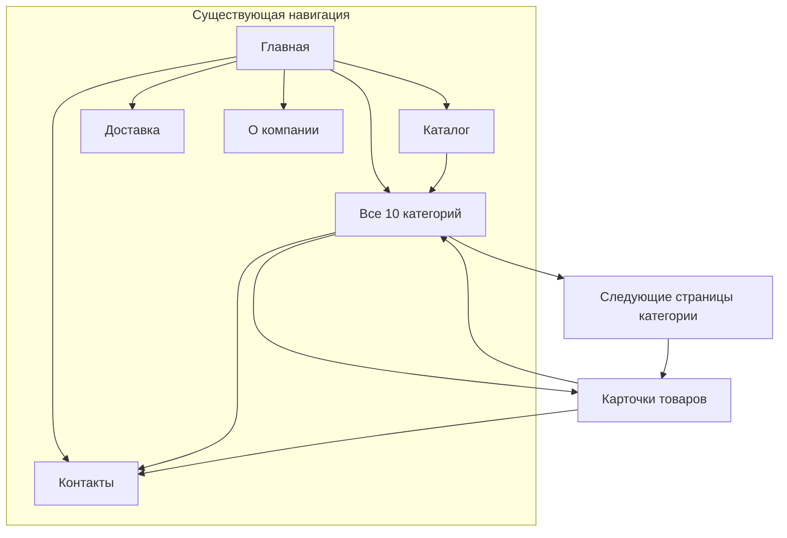

# Применение marketingskills к «Эталон Ковка»

Дата: 23 октября 2026. Статус: аудит завершён; пользователь согласовал только SEO-метаданные, без изменения видимого содержимого страниц. Полный пакет ниже сохранён как предложение.

## Согласованный объём

Реализованы локально только title и description для 10 категорий и страницы контактов. Отдельные SEO-данные хранятся в `src/data/category-seo.json` и не заменяют названия или описания в каталоге. Общий SEO-helper также использует их в метатегах Open Graph / Twitter; эти теги не меняют содержимое страницы. Метаданные следующих страниц категорий сохраняют номер страницы и собственный canonical.

Заголовки и тексты внутри страниц, счётчики, подписи про мастерскую и ручную работу, выбор категорий на главной, фотографии, формы и аналитика остаются прежними. Год основания 2006 сохраняется. Более широкий пакет ниже не утверждён к реализации.

Метаданные добавляют около 1 КБ gzip в отдельно загружаемую страницу категории. Общий лимит JS витрины скорректирован с 130 до 132 КБ для этих данных; лимиты стартовой загрузки и времени работы главной не меняются.

Проверено после реализации:

- Сборка: 395 HTML-маршрутов; SEO-проверка всех 393 индексируемых страниц проходит (59 проверок).
- 220 модульных тестов, 48 браузерных тестов, lint и проверка производительности проходят.
- На 24 затронутых страницах (категории, их пагинация и контакты) и на главной body HTML совпадает со снимком до этого этапа после нормализации служебных Vue-атрибутов. Проверка исходников каталога, главной, слайдера, панели категории и страницы «О компании» также не выявила изменений.
- В двух существующих браузерных сценариях добавлено ожидание подключения Vue перед вводом или кликом: готовый HTML может появляться раньше обработчиков. Поведение приложения для этого не менялось.
- Проверки сохранены в `output/seo/metadata-only-*.log` и `output/seo/metadata-only-scope-verification.json`. Публикация не выполнялась.

## Цель и границы

Привлекать обращения на подбор и поставку кованых элементов в Астане и по Казахстану. В этом проходе оцениваются соответствие содержания ассортименту, поисковому намерению и реальной модели бизнеса, локальные сведения, перелинковка и измеримость заявок.

Первый технический аудит уже добавил пагинацию, исправил дубли метаданных и проверил индексацию на уровне HTTP/HTML. Эти исправления остаются в рабочем проекте и пока не опубликованы. Здесь рассматривается следующий пакет, а не повторный список тех же технических проблем.

Применены установленные навыки `product-marketing`, `seo-audit`, `site-architecture`, `content-strategy`, `copywriting`, `cro` и `analytics`. Для текстов выбран режим B: сохранить существующую спокойную подачу и конкретизировать содержание из данных проекта. Новый дизайн сайта, новые городские страницы и массовая генерация карточек в пакет не входят.

## Данные и ограничения

- Прочитаны каталог, текущие страницы, первый аудит, конфигурация контактов, события аналитики и готовый HTML 393 индексируемых маршрутов.
- По графу HTML-ссылок: 4 товара доступны в один переход с главной, 150 — в два, 192 — в три, один — в четыре. Недостижимых товаров после первого аудита нет.
- У 172 товаров заполнено поле sourceUrl. Проверены две страницы первоисточника Bizzon; для них тексты характеристик совпадают. Это наблюдение по выборке, а не доказательство совпадения всех 172 описаний.
- Изучены примеры выдачи по тематике и первичные страницы продавца kuznets.kz и мастерской xan-temir.kz. Это качественная проверка моделей покупки; она не измеряет позиции, частотность или долю трафика.
- Данных Search Console, Яндекс.Вебмастера, Wordstat, фактической конверсии и квалифицированных заявок нет. Потенциальный рост и спрос в цифрах не оценивались. Наличие наших страниц среди результатов веб-поиска не подтверждает полноту индексации Google или Яндекса.
- Сырой снимок этого анализа: `output/seo/marketingskills-evidence-2026-10-23.json`.

## Находки и решения

| Приоритет | Наблюдение и доказательство | Что предлагается | Уверенность и проверка |
| --- | --- | --- | --- |
| Высокий | `CatalogView.vue`: «Каталог мастерской»; `HeroSlider.vue`: «Ателье металла». При этом AboutView прямо описывает продавца, который не является производителем | Привести эти подписи к «Каталог кованых элементов» и «Подбор и поставка» | Расхождение в текстах подтверждено. Проверить согласованность в HTML главной и каталога |
| Высокий | `AboutView.vue`: статические «5000+ Изделий» и «10+ Категорий». Источника для первой цифры не найдено; действующий каталог содержит 347 товаров и 10 категорий | Показывать фактическое число позиций и категорий из каталога. Год основания 2006 сохранить как подтверждённый владельцем | Не утверждаем, что 5000 исторически неверно: утверждаем отсутствие подтверждения и неясную метрику |
| Высокий | Описания категорий используют общие оценки «идеальны», «элегантный», «более прочные»; `kovanye-rucki` содержит неподтверждённую «ручную работу» | Назвать применение и параметры выбора; убрать непроверенные утверждения о технологии и прочности | Подтверждено по catalog.json; тексты проверяются по параметрам товаров |
| Средний | У всех 10 категорий title не обозначает местоположение; description почти повторяет общее описание группы | Подготовлены отдельные title и description с Астаной, назначением и понятным следующим действием | Наличие пропуска подтверждено; влияние на CTR и позиции остаётся гипотезой |
| Средний | `/catalog` и `/catalog/kovanye-elementy` обозначаются широким понятием «кованые элементы» | За каталогом закрепить широкий ассортимент, за категорией — отдельные детали: пики, барашки, эски и завитки | Риск пересечения намерения; фактическая каннибализация без GSC не доказана |
| Средний | Категория листьев в названии использует только «листики»; полный термин «листья» есть в описании | В SEO-заголовке естественно использовать оба термина; существующий URL сохранить | Семантическое уточнение, не заявление о частотности запросов |
| Средний | На главной показываются первые 8 из 10 категорий. `/product/6459` доступен через главную → каталог → листья → страницу 2 → товар | В существующей сетке главной показать все 10 категорий. Никакого дополнительного меню или нового компонента | Путь в четыре перехода подтверждён; после изменения проверить максимальную глубину товаров не больше трёх |
| Средний | Контактный title — просто «Контакты», description не содержит города, адреса и часов | Использовать существующую конфигурацию контактов для локального title/description | Контакты и часы уже опубликованы; нужно сохранить единый источник, а не дублировать их в коде |
| Средний | Панель заявки категории повторяет её описание и даёт одинаковый общий совет для разных групп | В том же блоке показать короткую подсказку по замеру/комплектации конкретной категории | Сценарий заявки существует; полезность подсказки проверять по качеству обращений |
| Низкий | Главная называет ручную подборку «Популярные товары», «Часто заказываемые позиции», но данные продаж в проекте отсутствуют | Представить эти же товары как примеры для начала подбора, сохранив выбранные артикулы | Неподтверждённое обоснование, а не доказанная ошибка состава подборки |
| Средний | События заявок существуют, но кнопка категории не отправляет `contact_form_open` с контекстом категории | Использовать существующее событие с `source=category_request` и slug категории; не передавать текст заявки, имя или телефон | Выявлено по исходникам. Не называть клик по мессенджеру завершённой продажей |

38 title длиннее 80 символов, 27 description длиннее 200. Это диагностические признаки, не автоматические SEO-ошибки: длину отображения определяет поисковая система. Массовое обрезание или замена технических характеристик не предлагается.

## Карта намерений и существующих страниц

Все запросы ниже — рабочие цели для страницы, а не измеренная семантика. Приоритет основан на соответствии имеющемуся ассортименту, не на выдуманном объёме спроса.

| Страница | Основное намерение | Уточняющие темы |
| --- | --- | --- |
| `/` | Кованые элементы в Астане, знакомство с поставщиком | География, способы заказа, ассортимент, контакты |
| `/catalog` | Каталог кованых элементов | Все категории и подбор по задаче |
| `/catalog/korony-na-vorota` | Короны на ворота и калитки | Ширина, высота рисунка, материал |
| `/catalog/nakladnye-dekorativnye-uzory` | Накладные кованые узоры | Рисунок, заполнение секций, симметрия |
| `/catalog/kovanye-ugolki` | Декоративные уголки для ворот | Внутренний размер рамы, направление, комплектность |
| `/catalog/kovanye-balyasiny` | Кованые балясины для лестниц | Высота, ширина, материал, повторение в ограждении |
| `/catalog/kovanye-rucki` | Кованые ручки для ворот, калиток и дверей | Размер, крепление, количество |
| `/catalog/kovanye-elementy` | Отдельные детали ковки | Пики, барашки, эски, завитки, сочетание деталей |
| `/catalog/uzory-iz-kvadrata-85x85` | Узоры из квадрата 8,5×8,5 мм | Размер рисунка и параметры сечения |
| `/catalog/uzory-iz-kvadratnoi-truby-15x15` | Узоры из трубы 15×15 мм | Габариты, вес, характеристики конкретного артикула |
| `/catalog/kovanye-stoiki` | Стойки для ограждений | Длина, сечение, комплектность |
| `/catalog/kovanye-listiki` | Кованые листья и листики | Форма, размер, дополнение узоров |
| `/constructor` | Собрать эскиз ворот, калитки или секции забора | Размеры, композиция, список деталей для обсуждения |
| `/contacts` | Найти адрес и связаться с продавцом | Астана, телефон, часы, заявка по категории |
| `/delivery` | Уточнить доставку по Казахстану | Город, габариты, вес, согласование способа и цены |

Существующие артикулы, названия товаров, URL категорий, canonical и пагинация сохраняются. Формулировка «купить» не подменяет реальную модель: цены и наличие требуют согласования.

## Конкретные тексты для проверки

Все 10 наборов title, description, вводного текста и подсказки заказа, а также точные замены главной и контактов находятся в [JSON-пакете](seo-marketingskills-proposal-2026-10-23.json). Это самостоятельный документ, ещё не используемый приложением.

Пример для балясин:

- Title: «Кованые балясины для лестниц в Астане» (бренд добавляет общий SEO-helper).
- Description: «Кованые балясины для лестниц и ограждений в Астане. Сравните форму, размеры и материал деталей. Подбор, цена и доставка по Казахстану по заявке.»
- Вводный текст: «Балясины для рисунка лестничных и балконных ограждений. Сравните высоту, ширину декоративной части и материал с параметрами вашего проекта.»
- Подсказка: «Пришлите высоту ограждения, длину пролёта и количество секций. Конструкцию и монтаж ограждения согласуйте с мастером; мы поможем подобрать детали.»

Главная, выбранный вариант:

- H1 первого слайда: «Кованые элементы для ворот и ограждений в Астане».
- Подзаголовок: «Короны, узоры, балясины и другие детали для вашего проекта. Подберём позиции по размерам или эскизу и согласуем поставку по Казахстану.»
- Подпись боковой панели: «Подбор и поставка».
- Заголовок панели: «Поможем составить заказ по фото, эскизу или артикулам.»
- Основное действие: существующее «Открыть каталог»; вторичное — уточнить подбор через контакты. Структура и внешний вид слайдера сохраняются.

Другие рассмотренные H1: «Каталог кованых элементов в Астане» — короче, но не объясняет применение; «Подберём кованые элементы по вашему эскизу» — описывает помощь, но хуже обозначает ассортимент и город. Выбранный вариант объединяет предмет и местоположение без обещания производства.

Другие CTA категории: «Уточнить цену и наличие» — конкретно для готового выбора; «Подобрать элементы» — подходит тем, кто ещё выбирает. Предлагается сохранить существующий переход к подготовленной заявке и уточнить подпись до «Подобрать элементы».

## Архитектура и перелинковка

```text
/ — все 10 категорий + примерные товары
├── /catalog — все категории и страницы каталога
│   └── /catalog/<slug> — назначение, подбор, товары
│       └── /catalog/<slug>/page/<n> — следующие товары
├── /product/<id> — параметры, категория, похожие товары, заявка
├── /constructor — эскиз и подборка деталей
├── /contacts — адрес и подготовленная заявка
├── /delivery — согласование доставки
└── /about — продавец, история и проверяемые сведения
```



Меню шапки, нижняя мобильная навигация и footer сохраняются. Исправляется выбор категорий в существующей сетке главной. Это предложение не требует переноса товарных URL на slug и риска миграции ради косметического изменения адреса.

## Контентные направления после первого пакета

| Направление | Материал / действие | Польза и отличие | Стадия | Приоритет |
| --- | --- | --- | --- | --- |
| Подбор деталей | 10 существующих категорий с конкретными параметрами выбора | Сразу связывает объяснение с доступными артикулами | Выбор / заказ | Сейчас |
| Композиция и комплектация | Пояснения к существующему конструктору и реальный пример подборки | Собственный рабочий инструмент, размеры и список деталей | Выбор | Следующий этап |
| Доставка и локальное доверие | Проверить условия самовывоза, ориентиры к точке и реальные фотографии | Сведения о конкретном продавце, которые не заменяет чужой каталог | Заказ | После подтверждения владельцем |
| Вопросы до заказа | Короткая инструкция «Какие размеры прислать для подбора» с примерами реальных товаров | Уменьшает неопределённость заявки; рекомендации по конструкции должен проверить мастер | Подготовка заявки | После проверки спроса и содержания |

Для нового материала сначала сравнить актуальную выдачу по его конкретному запросу и проверить, что мы добавляем полезный пример, инструмент или собственные данные. Отдельный блог, массовые страницы городов и статьи ради объёма сейчас не предлагаются.

## Локальное SEO и измерение

Адрес, телефон и часы уже централизованы и опубликованы. Поиск по бренду и адресу в исследованной выдаче не позволил надёжно идентифицировать профиль именно этой торговой точки. Поэтому вывод «профиля нет» не делается. Отзывы всего рынка «Эталон» нельзя приписывать нашему магазину.

Следующий шаг владельца: открыть реальные Google Business Profile, Яндекс.Бизнес / 2ГИС, сверить название, точный адрес точки, телефон, часы, сайт и фотографии. Изменение внешних профилей, создание дублей, отправка запросов клиентам и публикация отзывов в этот пакет не входят. У Google локальные результаты зависят от релевантности, расстояния и известности; увеличение зоны доставки не создаёт физический адрес в другом городе. [Официальное объяснение Google](https://support.google.com/business/answer/7091?hl=ru).

План измерения:

| Вопрос | Источник | Что считать |
| --- | --- | --- |
| Какие категории получают релевантные показы? | GSC / Яндекс.Вебмастер | Запросы, страницы, показы, клики, CTR; брендовые отдельно |
| Переходят ли к обсуждению заказа? | GA4 / Метрика после согласия | Существующие contact_form_open и generate_lead / lead_* с контекстом категории |
| Стало ли больше полезных обращений? | Учёт владельца | Реальные сообщения, квалифицированные заявки и согласованные заказы |

Сравнивать одинаковые завершённые интервалы после публикации и переобхода, учитывая сезонность и состав трафика. Клик по WhatsApp — намерение, не подтверждение отправки. Заявления об увеличении конверсии до получения данных не делаются.

## Пакет реализации после согласования

1. Внести 10 согласованных наборов контента в данные категорий; использовать отдельные SEO-поля и подсказку заказа в существующих CategoryView и CategoryRequestPanel.
2. Исправить указанные подписи главной/каталога и статические счётчики AboutView; контакты для metadata брать из CONTACTS.
3. Показать все 10 категорий в существующей сетке главной. Сохранить самостоятельные title/canonical пагинации и ItemList только видимых товаров.
4. Добавить контекст категории существующему событию открытия формы; сохранить consent и запрет передачи персональных данных в эти события.
5. Проверить HTML всех 393 страниц, отсутствие дублей, соответствие title содержанию, работоспособность заявок, все товары в пределах трёх переходов. Запустить lint, подходящие unit/E2E, сборку, verify:seo и verify:perf. Новых зависимостей не требуется. Текущий лимит JS почти исчерпан: изменение контента должно пройти его проверку; автоматическое увеличение лимита не запланировано.

Публикация и изменения внешних кабинетов потребуют отдельного действия после готовности и проверки пакета.

## Источники и рабочие документы

- [Контекст проекта](../.agents/product-marketing.md) — черновик по существующим фактам, без выдуманных интервью и результатов.
- [Точные тексты и карта целей](seo-marketingskills-proposal-2026-10-23.json).
- [Первый технический аудит](seo-audit-2026-10-23.md).
- [SEO title у Google](https://developers.google.com/search/docs/appearance/title-link) — описательные заголовки и соответствие странице.
- [Полезное содержание у Google](https://developers.google.com/search/docs/fundamentals/creating-helpful-content) — полезность, надёжность и собственная ценность текста.
- [Каталог продавца kuznets.kz](https://kuznets.kz/about/) и [мастерская xan-temir.kz](https://xan-temir.kz/) — примеры разных моделей предложения.
- [Карточка балясины Bizzon](https://bizzon.pro/kovanaya-balyasina-arka-55) и [карточка короны Bizzon](https://bizzon.pro/kovanaya-korona-na-vorota-astana-6) — проверка происхождения характеристик в выборке.
